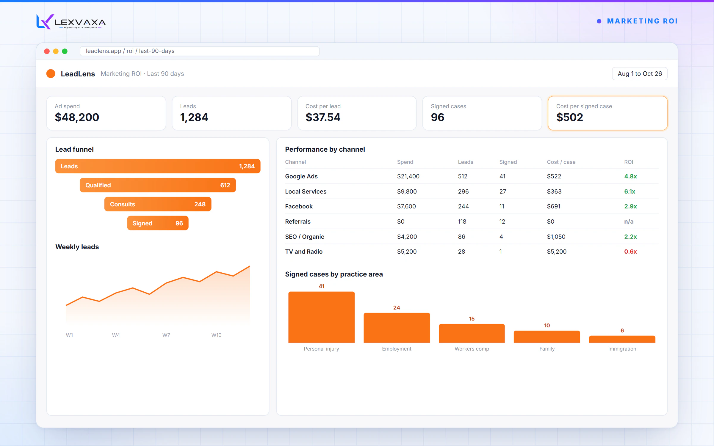

# LeadLens: Legal Marketing ROI Dashboard

**A marketing dashboard for a law firm that joins ad data with intake and case data to show cost per lead and cost per signed case for every channel.**

       

## Overview

The firm could see ad spend and clicks, but not which channels produced signed cases. Lexvaxa built LeadLens, a custom dashboard that joins ad platform data with intake and case data. Partners see spend, leads, cost per lead and cost per signed case, a lead funnel from first contact to signed, weekly leads and signed cases, signed cases by practice area and a performance table for every channel. Screens shown use sample data, so no client records are exposed.

## The challenge

Marketing reports stopped at clicks and leads, so budget decisions could not be tied to the cases the firm actually signed.

## The solution

n8n pipelines pull ad spend from the ad platforms and match it with intake and case records, feeding a React dashboard and a channel ROI table.

## Key features

- Ad spend, leads, cost per lead and cost per signed case
- Lead funnel from lead to signed case
- Weekly leads and signed cases
- Signed cases by practice area
- Spend and ROI by channel
- Campaign performance table

## Results

- Budget decisions are based on signed cases, not just clicks

## Tech stack

React · Python · Google Ads API · n8n · Google Sheets · Looker · CRM data

## Demo

A working version of the dashboard UI with **sample data** is in [`demo/index.html`](demo/index.html). Download it and open it in a browser; it has no build step.

## Privacy

Client names and records are confidential. Every screen in this repository uses sample data, and source code that belongs to the client is not published.

## Links

- Case study on Lexvaxa: https://lexvaxa.com/work/legal-marketing-roi-dashboard
- Built by **Ch Muhammad Samiullah** ([GitHub](https://github.com/samiullah156-creator)) at [Lexvaxa](https://lexvaxa.com)
